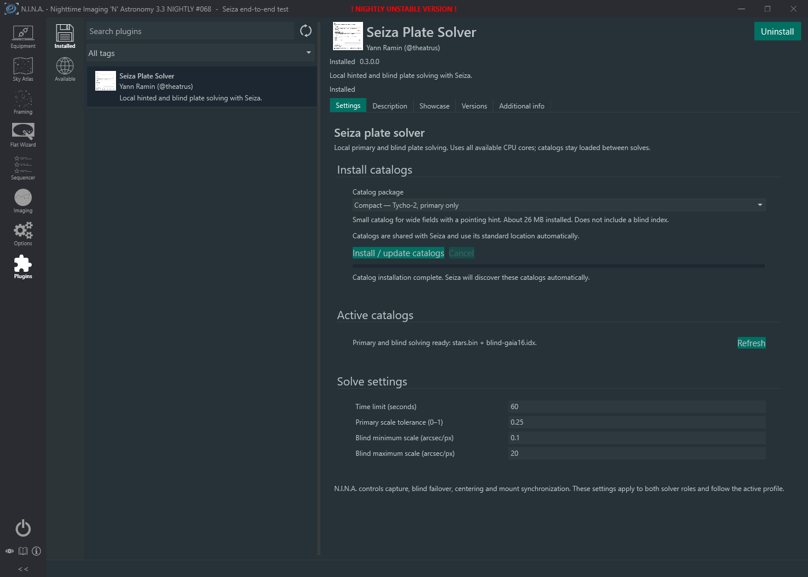
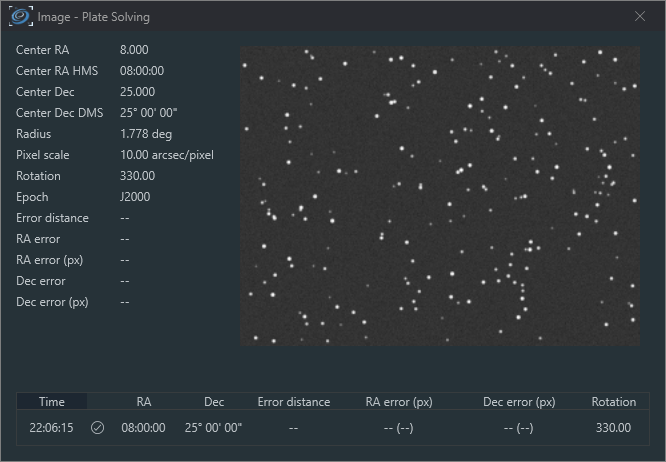

# Seiza for N.I.N.A.

Native, offline plate solving with [Seiza](https://github.com/theatrus/seiza),
available as both a primary solver and a blind solver in N.I.N.A.
Uses the upstream plugin provider API from
[isbeorn/nina#449](https://github.com/isbeorn/nina/pull/449).

**Requires a Windows x64 N.I.N.A. develop build containing that merge.**
The initial reference build is 3.3.0.1068 at commit
`83e4a4fc4a739a1a174a4ad3262f5cdc34b2541b`.
A version number alone does not establish compatibility: an earlier binary
with the same number can lack the new interfaces. Stable N.I.N.A. 3.2 is
not supported. This plugin does not require a fork of N.I.N.A.



The plugin page in the full upstream N.I.N.A. application after an end-to-end
test and Compact catalog installation. The same controls are embedded in
Plate Solving options.

## Install

1. Build the plugin below, or download the Windows artifact from this
   repository's [Actions](https://github.com/theatrus/seiza-nina/actions).
2. Close N.I.N.A. Copy the contents of the plugin ZIP into a `Seiza`
   subdirectory of your develop build's versioned plugin directory.
   For the reference develop build this is
   `%LOCALAPPDATA%\NINA\Plugins\3.0.0\Seiza` (the folder follows N.I.N.A.'s
   plugin compatibility version).
   Keep `Seiza.Nina.dll` and `seiza_nina_native.dll` together.
3. Restart N.I.N.A. In **Options > Plate Solving**, choose **Seiza** for
   the primary solver, blind solver, or both. Its settings appear underneath
   the selectors, once when both roles select Seiza.
4. Open the **Seiza Plate Solver** plugin page, or use the embedded settings
   in Plate Solving options. Choose a catalog package,
   then click **Install / update catalogs**. The plugin includes the downloader
   and native solver; no separate CLI is required.

| Catalog package | Contents | Approximate installed size |
| --- | --- | --- |
| Standard | Gaia G17 stars and the blind index; recommended for both solver roles | 3.2 GB |
| Compact | Tycho-2 stars for primary solving in wider fields; no blind index | 26 MB |
| Deep | Gaia G20 stars and the blind index for faint, narrow fields | 10.3 GB |

Install controls show the current file, downloaded bytes, verification and
installation progress, and support cancellation. Downloads use Seiza's shared
cache, with SHA-256 verification before publishing catalog files. New files
are staged before atomically replacing individual existing files. Solves wait
while installation runs, so the plugin can release its catalog mappings safely.
Completed cache downloads are kept for reuse. Installation and solving use
Seiza's standard shared catalog location automatically. There are no plugin
path fields or per-profile catalog overrides. **Refresh** checks locally available catalogs.

Catalogs can also be shared with other Seiza applications or installed with
the optional [Seiza CLI](https://github.com/theatrus/seiza/releases).
The plugin calls Seiza's native default-directory and discovery functions,
including its standard `SEIZA_CATALOG_DIR`, `SEIZA_STAR_DATA` and
`SEIZA_BLIND_INDEX` environment overrides. Old plugin path settings are ignored.
The deepest available star catalog is selected. For blind solves the adapter
opens the index beside that catalog. A primary solve needs only
the star catalog. A blind solve also needs the prebuilt blind index;
the plugin does not build an all-sky index during a solve.

Settings belong to the active N.I.N.A. profile. The default solve time limit
is 60 seconds, primary scale tolerance is 0.25 (±25%), and blind scale bounds
are 0.1–20 arcsec/pixel. Set telescope focal length, camera pixel size and
pointing in N.I.N.A. as usual. N.I.N.A. controls retries, blind failover,
centering and synchronization.

## Build and verify

Install Git, the .NET 10 SDK, and stable Rust with the MSVC x64 toolchain
and Visual C++ build tools. Run from this repository:

```powershell
./scripts/build.ps1 -Test
```

The script clones the exact N.I.N.A. revision from `upstream.json` into
the ignored `.deps/nina` directory, builds Seiza from the locked published
crates, runs native and .NET tests, then writes a plugin ZIP and SHA-256
checksum under `artifacts/`. It packages only the plugin and native bridge;
N.I.N.A. supplies the managed host assemblies. The ZIP is a development
artifact and is not Authenticode signed or submitted to the plugin registry.

To use an existing upstream checkout:

```powershell
./scripts/build.ps1 -Test -NinaSourcePath C:\src\nina
```

The tests generate an artificial star field, catalog and blind index. They
exercise actual pixel detection and primary/blind solving, the upstream
factory, MEF composition, N.I.N.A.'s real plugin assembly load context,
embedded WPF settings, profiles, cancellation and shutdown. They do not
operate astronomy equipment or need external catalogs.

### Full N.I.N.A. end-to-end test

With N.I.N.A.'s external native/camera SDK assets restored in the source checkout,
run from an interactive Windows desktop using PowerShell 7.4 or newer:

```powershell
./scripts/test-nina.ps1 -InstallCatalogs
# Add -KeepOpen to leave N.I.N.A. open for inspection.
# Add -NinaSourcePath C:\src\nina to use another prepared upstream checkout.
```

This optional test builds and starts the real `NINA.App`, composes its normal
main window and lets its plugin loader discover the deployed plugin. It uses
an isolated application directory, profile, database and Seiza catalog directory
under `artifacts/nina-e2e/`. It writes and loads a synthetic FITS image through
N.I.N.A., tests primary/blind solving, a primary miss, automatic blind failover,
cancellation recovery, and the actual image **Plate Solve** command/result window.
It also verifies the live plugin page has working installation controls and no
path fields. JSON results and WPF-rendered screenshots are saved beside its logs.
`-InstallCatalogs` additionally downloads/verifies/installs the real 26 MB Compact
catalog into that isolated default location; it reuses Seiza's normal download cache.

The full app test requires vendor SDK files absent from a plain N.I.N.A. Git clone,
so it runs separately from the ordinary build/CI suite. It does not connect equipment.



## Implementation

The MEF export implements `IPlateSolverProvider` with the stable provider ID
`fyi.seiza.nina.plate-solver`. A separate `PluginBase` manifest owns shutdown.
The plugin GUID is `66d7411d-b4b6-470b-9f34-d1578699c834`.

The C# adapter passes N.I.N.A.'s linear 16-bit mono/Bayer pixels directly
to a small Rust bridge. Seiza 0.40.1 owns detection, matching, WCS fitting,
catalog resolution and memory mapping. No temporary FITS files or solver
processes are created. Catalog mappings are reused, the blind index opens
on first use, and work is serialized across both solver roles. The built-in
installer invalidates that cache. Replacing catalog files externally
requires restarting N.I.N.A.

Primary solves use N.I.N.A.'s J2000 coordinates, search radius and effective
pixel size (including capture binning). They return an unsuccessful result
on no match so N.I.N.A. can run its configured blind failover. Blind solves
use the configured scale range without pointing hints. Detection honours
the requested downsampling (1–8) and maximum objects (32–2000, 600 by
default); Bayer frames use even-sized averaging blocks. Detection centroids
are restored to original pixel coordinates before fitting, so output scale
remains in captured-image pixels. Initial solutions are linear TAN without
SIP distortion fitting.

The native solver uses all available logical CPU cores. Cancellation and deadlines
are cooperative: decoding is unnecessary, averaging checks each row, and
Seiza checks between search stages. Detection and initial catalog/index
mapping cannot be interrupted mid-operation, so cancellation can take one
stage to return. Teardown cancels active and queued solves before freeing
the engine. Only star-confirmed solutions are returned; image header WCS
is never accepted as a successful solve by itself.

The manifest and solver provider share profile settings across N.I.N.A.'s
separate MEF containers. Both page templates bind to the same catalog installer.
Catalog installation uses the published `seiza-download` 0.9.0 manifest, cache,
transport and verification APIs; the plugin selects only solver datasets.

The result adapter uses N.I.N.A.'s `WorldCoordinateSystem` and the same
position-angle/parity convention as its ASTAP adapter. Tests cover these
conventions and binning/downsampling independently of file header metadata.

Code is Apache-2.0. See [third-party notices](THIRD-PARTY-NOTICES.md) for
Seiza and host licenses. Catalog downloads retain their own data licenses.
